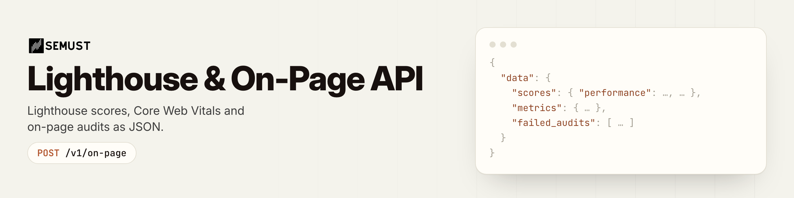
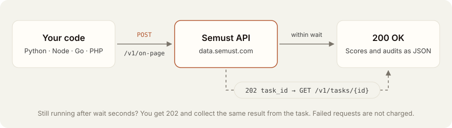
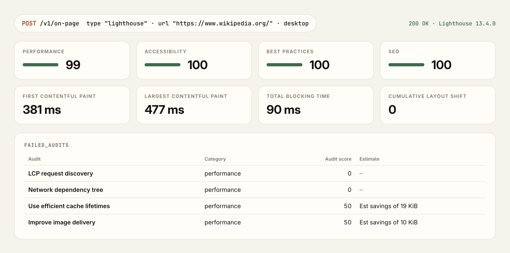

# Lighthouse & On-Page API

[](https://semust.com/en/api-platform/on-page-api?utm_source=github&utm_medium=referral&utm_campaign=lighthouse-on-page-api&utm_content=banner)

[](https://app.semust.com/api/access?utm_source=github&utm_medium=referral&utm_campaign=lighthouse-on-page-api&utm_content=badge)
[](https://semust.com/en/docs/api/on-page?utm_source=github&utm_medium=referral&utm_campaign=lighthouse-on-page-api&utm_content=badge)
[](https://github.com/Semust-com/semust-mcp)
[](LICENSE)

The [Semust Lighthouse & On-Page SEO API](https://semust.com/en/api-platform/on-page-api?utm_source=github&utm_medium=referral&utm_campaign=lighthouse-on-page-api&utm_content=intro) checks one page the way Google and a browser see it. One endpoint, three reports: a full **Lighthouse** run (performance, accessibility, best practices and SEO scores, Core Web Vitals and every failed audit, on mobile or desktop), a fast **on-page SEO audit** (title, description, headings, word count, links, page size, load time and the problems found), and the page's main **content** as structured sections and Markdown. Send a URL and get clean JSON back. No headless Chrome fleet to run on your side.

It is built for SEO teams, developers and agencies who need **Core Web Vitals monitoring, performance budgets in CI, on-page audits at scale and clean page content for AI workflows**. The API is part of the [Semust](https://semust.com/en?utm_source=github&utm_medium=referral&utm_campaign=lighthouse-on-page-api&utm_content=intro) SEO platform.

- [How it works](#how-it-works)
- [Request parameters](#request-parameters)
- [Output sample](#output-sample)
- [JSON output structure](#json-output-structure)
- [Errors](#errors)
- [Pricing](#pricing)
- [Use cases](#use-cases)
- [FAQ](#faq)

## How it works

<picture>
  <source media="(prefers-color-scheme: dark)" srcset="images/how-it-works-dark.svg">
  
</picture>

### 1. Get your API credentials

Create an API user on the [Semust API access page](https://app.semust.com/api/access?utm_source=github&utm_medium=referral&utm_campaign=lighthouse-on-page-api&utm_content=credentials). You get a username and a password. Every request sends them as two headers:

| Header | Value |
| --- | --- |
| `SEMUST-API-USER` | Your API username |
| `SEMUST-API-PASSWORD` | Your API password |

The examples in this repository read them from environment variables, so they never end up in your code:

```bash
export SEMUST_API_USER="your_username"
export SEMUST_API_PASSWORD="your_password"
```

> [!TIP]
> There is no subscription. You top up a prepaid balance and pay only for successful requests; failed requests are refunded automatically. Prices are on the [Lighthouse & On-Page API page](https://semust.com/en/api-platform/on-page-api?utm_source=github&utm_medium=referral&utm_campaign=lighthouse-on-page-api&utm_content=pricing).

### 2. Send a request

```python
import os, time, requests

HEADERS = {
    "SEMUST-API-USER": os.environ["SEMUST_API_USER"],
    "SEMUST-API-PASSWORD": os.environ["SEMUST_API_PASSWORD"],
}

resp = requests.post(
    "https://data.semust.com/v1/on-page",
    params={"wait": 60},
    headers=HEADERS,
    json={"type": "lighthouse", "url": "https://www.wikipedia.org/", "device": "desktop"},
    timeout=90,
)
while resp.status_code == 202:  # still running: poll the task
    time.sleep(int(resp.headers.get("Retry-After", 5)))
    resp = requests.get(resp.json()["poll_url"], headers=HEADERS, timeout=30)

data = resp.json()["data"]
print(data["scores"])                                # {'performance': 99, 'accessibility': 100, ...}
print(data["metrics"]["largest_contentful_paint_ms"], "ms LCP")
```

### 3. Run the examples

| Language | File | Run |
| --- | --- | --- |
| Python | [`examples/python/on_page.py`](examples/python/on_page.py) | `python on_page.py https://www.wikipedia.org/ desktop` |
| Python, Core Web Vitals monitor | [`examples/python/cwv_monitor.py`](examples/python/cwv_monitor.py) | `python cwv_monitor.py urls.txt --device mobile` |
| Node.js 18+ | [`examples/node/on_page.mjs`](examples/node/on_page.mjs) | `node on_page.mjs https://www.wikipedia.org/ desktop` |
| Go | [`examples/go/main.go`](examples/go/main.go) | `go run . https://www.wikipedia.org/ desktop` |
| PHP | [`examples/php/on_page.php`](examples/php/on_page.php) | `php on_page.php https://www.wikipedia.org/ desktop` |
| cURL | [`examples/curl/on_page.sh`](examples/curl/on_page.sh) | `./on_page.sh` |

## Request parameters

`POST https://data.semust.com/v1/on-page` with a JSON body. One endpoint serves three reports, chosen with `type`.

| Parameter | Type | Default | Description |
| --- | --- | --- | --- |
| `type` | string | `lighthouse` | The report to run: `lighthouse`, `audit` or `content`. |
| `url` **(required)** | string | – | The page to check, up to 2,048 characters. A missing scheme gets `https://`. Only public `http` and `https` addresses on a domain name: no `localhost` or IP addresses. |
| `idempotency_key` | string | – | Up to 128 characters. Same effect as the `Idempotency-Key` header. |

**Report types and their parameters**

| `type` | Returns | Parameter | Type | Default | Description |
| --- | --- | --- | --- | --- | --- |
| `lighthouse` | Category scores, Core Web Vitals and every failed audit. Typically 10–30 s. | `device` | string | `mobile` | `mobile` or `desktop`. |
| | | `categories` | array | all four | Any of `performance`, `accessibility`, `best_practices`, `seo`. `best-practices` is accepted too. |
| | | `language` | string | `en` | Language of audit titles and descriptions; 42 languages. |
| `audit` | On-page SEO audit: title, description, canonical, headings, word count, readability, links, page size, load timing and the problems found. About 1 s. | `javascript` | boolean | `false` | Render the page with JavaScript before auditing (about 3 s, higher price). |
| `content` | The page's main content as sections (heading and text), contact details, and optionally the whole page as Markdown. About 1 s. | `markdown` | boolean | `false` | Also return the page as Markdown. Same price. |

A parameter that the chosen `type` does not take is refused with `PARAMETER_NOT_ALLOWED`, and a misspelt one gets a "did you mean" hint.

| Query parameter | Default | Description |
| --- | --- | --- |
| `wait` | `60` | Seconds to hold the connection before answering `202`, 0–80. `0` answers `202` at once (fire and collect). |

| Header | Description |
| --- | --- |
| `Idempotency-Key` | Optional, up to 128 characters. Repeating a request with the same key returns the same task and is charged once. |
| `Accept-Language` | Optional. Send `tr` to receive error messages in Turkish. |

**Languages.** `GET https://data.semust.com/v1/on-page/languages` (same headers, free) lists the languages Lighthouse can write its audit text in: `{"success": true, "default_language": "en", "languages": [{"language": "de", "name": "German"}, …]}`.

## Output sample



The response for `{"type": "lighthouse", "url": "https://www.wikipedia.org/", "device": "desktop"}`. Lists are cut to two items and long strings shortened; the complete response, with the per-call `request_id` removed, is in [`output-lighthouse-on-page-api.json`](output-lighthouse-on-page-api.json).

```json
{
  "success": true,
  "type": "lighthouse",
  "url": "https://www.wikipedia.org/",
  "device": "desktop",
  "categories": [
    "performance",
    "accessibility"
  ],
  "language": "en",
  "data": {
    "final_url": "https://www.wikipedia.org/",
    "lighthouse_version": "13.4.0",
    "fetched_at": "2026-11-16T03:14:22Z",
    "scores": {
      "performance": 99,
      "accessibility": 100,
      "best_practices": 100,
      "seo": 100
    },
    "metrics": {
      "first_contentful_paint_ms": 381,
      "largest_contentful_paint_ms": 477,
      "total_blocking_time_ms": 90,
      "cumulative_layout_shift": 0,
      "speed_index_ms": 936,
      "time_to_interactive_ms": 537
    },
    "failed_audits": [
      {
        "id": "lcp-discovery-insight",
        "category": "performance",
        "title": "LCP request discovery",
        "description": "[Optimize LCP](https://developer.chrome.com/docs/performance/insights/lcp-discovery) by making the LCP image discoverable from the HTML immediately, and avoi...",
        "score": 0,
        "display_value": null,
        "savings_ms": null,
        "savings_bytes": null
      },
      {
        "id": "network-dependency-tree-insight",
        "category": "performance",
        "title": "Network dependency tree",
        "description": "[Avoid chaining critical requests](https://developer.chrome.com/docs/performance/insights/network-dependency-tree) by reducing the length of chains, reducing...",
        "score": 0,
        "display_value": null,
        "savings_ms": null,
        "savings_bytes": null
      }
    ],
    "passed_count": 68,
    "failed_count": 4,
    "warnings": []
  },
  "cost": 0.0055,
  "cached": false
}
```

## JSON output structure

**Top-level fields**

| Field | Type | Description |
| --- | --- | --- |
| `success` | boolean | `true` when the check ran. |
| `type` | string | The report that ran. |
| `url` | string | The address as checked: scheme and host lowercased, the host in ASCII (punycode) form, no `#fragment`. |
| `device`, `categories`, `language` | string, array, string | `lighthouse` only. The options the run used, defaults filled in. |
| `javascript` | boolean | `audit` only. Whether the page was rendered with JavaScript. |
| `markdown` | boolean | `content` only. Whether Markdown was requested. |
| `data` | object | The report, below. |
| `cost` | number | What this request cost, in USD. |
| `cached` | boolean | `true` when the same request made a few minutes earlier was answered from its stored result. |
| `request_id` | string | The task id. `GET /v1/tasks/{request_id}` returns the same response for 72 hours. |

**`lighthouse` data**

| Field | Type | Description |
| --- | --- | --- |
| `final_url` | string | Where the page ended up after redirects. |
| `lighthouse_version` | string | The Lighthouse version that ran. |
| `fetched_at` | string \| null | When the page was loaded (ISO 8601, UTC). |
| `scores` | object | `performance`, `accessibility`, `best_practices`, `seo`: 0–100 as PageSpeed Insights shows them, `null` for a category not requested. |
| `metrics` | object \| null | Lab measurements: `first_contentful_paint_ms`, `largest_contentful_paint_ms`, `total_blocking_time_ms`, `speed_index_ms`, `time_to_interactive_ms` and the unitless `cumulative_layout_shift`. `null` unless `performance` was requested. |
| `failed_audits` | array | Each failed check: `id`, `category`, `title`, `description` (Markdown, in the requested language), `score` (0–100), `display_value`, `savings_ms`, `savings_bytes`. |
| `passed_count`, `failed_count` | integer | Scored checks that passed and failed in the requested categories. |
| `warnings` | array | Lighthouse's own notes about the run, such as a redirect or a slow page. |

**`audit` data**

| Field | Type | Description |
| --- | --- | --- |
| `final_url`, `status_code` | string, integer | The address that answered after redirects, and its HTTP status. |
| `score` | number \| null | On-page score, 0–100. |
| `title`, `description`, `canonical` | string \| null | The `<title>`, meta description and canonical link. |
| `h1`, `headings` | array, object | The H1 texts, and the number of headings at each level `h1`…`h6`. |
| `word_count`, `readability` | integer \| null, number \| null | Words of visible text, and the Flesch reading-ease score. |
| `links` | object | `internal` and `external` link counts. |
| `images`, `scripts`, `stylesheets` | integer \| null | Counts on the page. |
| `size_bytes`, `transfer_bytes` | integer \| null | HTML size, and bytes transferred. |
| `load_time_ms`, `timing` | integer \| null, object | Total load time, and `connect_ms`, `waiting_ms`, `download_ms`, `dom_complete_ms`, `time_to_interactive_ms`. |
| `issues` | array | The problems found, by name: for example `no_h1_tag`, `title_too_long`, `no_description`, `not_canonical`, `no_image_alt`, `render_blocking_resources`, `high_loading_time`, `low_readability_rate`, `broken_links`, `structured_data_errors`. An empty list means none. |
| `fetched_at` | string \| null | When the page was fetched (ISO 8601, UTC). |

**`content` data**

| Field | Type | Description |
| --- | --- | --- |
| `title` | string \| null | The page's main heading. |
| `language` | string \| null | The content's language, e.g. `en`. |
| `sections`, `secondary_sections` | array | `level`, `heading` and `text` for each section. `sections` is the main content; `secondary_sections` is what surrounds it. |
| `word_count` | integer | Words in `sections`. |
| `contacts` | object | `emails` and `phones` found on the page. |
| `markdown` | string \| null | The whole page as Markdown with `"markdown": true`, otherwise `null`. |

Every documented field is always present; a value that does not apply is `null`.

## Long-running requests (202 and polling)

Most requests finish in a few seconds and return `200` with the result. If a request is still running after `wait` seconds (60 by default, maximum 80), the API returns `202 Accepted` with a `task_id` instead. Nothing is lost and you are not charged twice:

1. Read `task_id` from the body (also in the `X-Task-Id` header).
2. Wait `Retry-After` seconds.
3. Call `GET https://data.semust.com/v1/tasks/{task_id}` with the same headers until the status is no longer `202`. The final answer is exactly what the original request would have returned.

Every example in [`examples/`](examples) already handles this. Results stay available for 72 hours, and fetching them again is free. Set your HTTP client's read timeout above `wait` (for example `wait + 30` seconds). Send an `Idempotency-Key` header to retry a request safely without paying twice. Details: [Tasks & long-running requests](https://semust.com/en/docs/api/tasks?utm_source=github&utm_medium=referral&utm_campaign=lighthouse-on-page-api&utm_content=tasks).

## Errors

Errors return JSON with a readable `error`, a stable `code` and `retryable`; where it helps also `field`, `hint` and `allowed` (the valid values). Failed requests are not charged.

| HTTP | `code` | Meaning |
| --- | --- | --- |
| 400 | `INVALID_JSON`, `UNKNOWN_PARAMETER`, `INVALID_PARAMETER` | The body is not a JSON object, a parameter is unknown (`hint` suggests the closest one), or a value is invalid (`field` names it). |
| 400 | `INVALID_TYPE`, `PARAMETER_NOT_ALLOWED` | Unknown `type`, or a parameter this `type` does not take. |
| 400 | `URL_REQUIRED`, `INVALID_URL` | `url` is missing, or it is not a public `http`/`https` address. |
| 401 | `MISSING_CREDENTIALS`, `INVALID_CREDENTIALS`, `CREDENTIALS_EXPIRED` | Check the two auth headers. |
| 402 | `INSUFFICIENT_CREDITS` | Your balance does not cover the request; `required` and `balance` say by how much. |
| 403 | `IP_NOT_WHITELISTED`, `SERVICE_NOT_ENABLED` | Your API user only accepts listed IP addresses, or this API is not enabled for it. |
| 409 | `REQUEST_IN_PROGRESS` | A request with the same idempotency key is still running. |
| 413 | `REQUEST_TOO_LARGE` | The body is over 16 KB. |
| 422 | `PAGE_BLOCKED` | The site refused the request (HTTP 401, 403 or 429), usually bot protection. Not charged. |
| 422 | `PAGE_UNAVAILABLE` | The page answered with an error status, did not resolve or did not answer, or has no readable content. Not charged; `retryable` says whether trying again can help. |
| 429 | `RATE_LIMIT_EXCEEDED`, `TOO_MANY_CONCURRENT_REQUESTS`, `TOO_MANY_PENDING_TASKS` | Per-minute or per-day limit reached, or too many requests running at once. Wait `Retry-After` seconds. |
| 500 | `INTERNAL_ERROR` | Something went wrong on our side. Quote `request_id` to support. |
| 503 | `REQUEST_FAILED`, `SERVICE_BUSY`, `SERVICE_UNAVAILABLE`, `TIMEOUT` | Temporary failure. Retry when `retryable` is `true`, with the same `Idempotency-Key`. |

A blocked page is an error rather than a result on purpose: behind bot protection Lighthouse would score the challenge page, not your site.

## Pricing

Flat, per request:

| Request | Price |
| --- | --- |
| `lighthouse` (any device, any categories) | **$0.0055** |
| `audit` | **$0.000165** |
| `audit` with `"javascript": true` | **$0.00165** |
| `content` (with or without Markdown) | **$0.000165** |

Blocked, unavailable and failed pages are refunded automatically. Current prices are on the [Lighthouse & On-Page SEO API page](https://semust.com/en/api-platform/on-page-api?utm_source=github&utm_medium=referral&utm_campaign=lighthouse-on-page-api&utm_content=pricing).

## Use cases

1. **Core Web Vitals monitoring.** Run Lighthouse on your key templates every day and log LCP, CLS and TBT with their good / needs-improvement / poor rating. Start from [`cwv_monitor.py`](examples/python/cwv_monitor.py), which appends to a CSV.
2. **Performance budgets in CI.** Fail a deploy when the performance score or LCP of a preview URL crosses your budget.
3. **On-page audits at scale.** At $0.000165 a page, the `audit` report checks titles, descriptions, H1s, word count and broken links across thousands of URLs.
4. **Competitor benchmarking.** Compare your pages' scores and Core Web Vitals with the pages that outrank you, on mobile and desktop.
5. **Content for AI and LLM workflows.** Use `content` with `"markdown": true` to give an AI model a page's main text without navigation, ads and markup.

## Why Semust

- **Pay as you go.** No monthly plan or minimum commitment for the API. Top up once, pay per successful request, and get failed requests refunded automatically.
- **One account, every SEO dataset.** SERP, keyword data, backlinks, domain research, YouTube, Google Trends, Lighthouse and Google Business data use the same credentials, the same error format and the same task system.
- **Any country, any language.** Localised results for every Google market, including strong coverage of Türkiye and Turkish-language queries.
- **Built for AI workflows.** Plug the same data into Claude, Cursor or ChatGPT with the open-source [Semust MCP server](https://github.com/Semust-com/semust-mcp).

## FAQ

### Are these Core Web Vitals field data or lab data?

Lab data: Lighthouse loads the page once in a controlled environment and measures it. That makes runs comparable and repeatable, but it is not the same as the real-user (field) data in Search Console. Interaction to Next Paint needs real users, so Total Blocking Time is the lab metric to watch for responsiveness.

### Mobile or desktop?

`mobile` is the default, because it is what Google ranks with and what PageSpeed Insights opens with. Send `"device": "desktop"` for a desktop run. The price is the same.

### Why did I get `PAGE_BLOCKED`?

The site answered 401, 403 or 429, almost always bot protection such as a CDN challenge. You are not charged. Allow automated checks for the page, or try `audit` without `javascript`: sites that block headless browsers often still answer a plain fetch.

### Which report should I use?

`lighthouse` for speed, accessibility and Core Web Vitals. `audit` for fast, low-cost on-page SEO checks across many URLs. `content` when you need the page's text, for example as input to an AI model.

### Can I get the audit text in another language?

Yes, for `lighthouse`. Set `language` to one of 42 languages, such as `de`, `fr` or `tr`; `GET /v1/on-page/languages` lists them for free.

### Can I use it from Claude, ChatGPT or Cursor?

Yes. The [Semust MCP server](https://github.com/Semust-com/semust-mcp) connects your Semust account to AI assistants, and the [SEO MCP](https://semust.com/en/features/mcp/seo-mcp?utm_source=github&utm_medium=referral&utm_campaign=lighthouse-on-page-api&utm_content=mcp) gives them Search Console, rank tracking, indexing and competitor tools.

## Learn more

- [On-Page API documentation](https://semust.com/en/docs/api/on-page?utm_source=github&utm_medium=referral&utm_campaign=lighthouse-on-page-api&utm_content=learn_more) · [Turkish documentation](https://semust.com/docs/api/on-page?utm_source=github&utm_medium=referral&utm_campaign=lighthouse-on-page-api&utm_content=learn_more)
- [Core Web Vitals guide (Turkish)](https://semust.com/blog/core-web-vitals?utm_source=github&utm_medium=referral&utm_campaign=lighthouse-on-page-api&utm_content=learn_more)
- [Technical SEO guide](https://semust.com/en/blog/technical-seo?utm_source=github&utm_medium=referral&utm_campaign=lighthouse-on-page-api&utm_content=learn_more)
- [On-page SEO tools (Turkish)](https://semust.com/blog/on-page-seo-araclari?utm_source=github&utm_medium=referral&utm_campaign=lighthouse-on-page-api&utm_content=learn_more)
- [Free AI indexability checker](https://semust.com/en/free-seo-tools/ai-indexability-checker?utm_source=github&utm_medium=referral&utm_campaign=lighthouse-on-page-api&utm_content=learn_more) and [text extractor](https://semust.com/en/free-seo-tools/text-extractor?utm_source=github&utm_medium=referral&utm_campaign=lighthouse-on-page-api&utm_content=learn_more)

## Related repositories

**SEO data APIs**

| Repository | What it does | Product page |
| --- | --- | --- |
| [google-serp-scraper](https://github.com/Semust-com/google-serp-scraper) | Organic results, People Also Ask, AI Overviews, ads and more as JSON | [Google SERP API](https://semust.com/en/api-platform/serp-api?utm_source=github&utm_medium=referral&utm_campaign=lighthouse-on-page-api&utm_content=related) |
| [google-images-scraper](https://github.com/Semust-com/google-images-scraper) | Google Images results with titles, source pages and image URLs | [Google Images API](https://semust.com/en/api-platform/google-images-api?utm_source=github&utm_medium=referral&utm_campaign=lighthouse-on-page-api&utm_content=related) |
| [youtube-scraper](https://github.com/Semust-com/youtube-scraper) | YouTube search, video details, transcripts and comments | [YouTube API](https://semust.com/en/api-platform/youtube-api?utm_source=github&utm_medium=referral&utm_campaign=lighthouse-on-page-api&utm_content=related) |
| [google-trends-scraper](https://github.com/Semust-com/google-trends-scraper) | Interest over time, regions, related queries and demographics | [Google Trends API](https://semust.com/en/api-platform/trends-api?utm_source=github&utm_medium=referral&utm_campaign=lighthouse-on-page-api&utm_content=related) |
| [google-business-scraper](https://github.com/Semust-com/google-business-scraper) | Google Business profiles, local search and reviews | [Google Business Data API](https://semust.com/en/api-platform/business-data-api?utm_source=github&utm_medium=referral&utm_campaign=lighthouse-on-page-api&utm_content=related) |
| [keyword-research-api](https://github.com/Semust-com/keyword-research-api) | Search volume, CPC, competition, intent and related keywords | [Keyword Research API](https://semust.com/en/api-platform/keyword-research-api?utm_source=github&utm_medium=referral&utm_campaign=lighthouse-on-page-api&utm_content=related) |
| [backlinks-api](https://github.com/Semust-com/backlinks-api) | Backlinks, referring domains, anchors and link history | [Backlinks API](https://semust.com/en/api-platform/backlinks-api?utm_source=github&utm_medium=referral&utm_campaign=lighthouse-on-page-api&utm_content=related) |
| [domain-research-api](https://github.com/Semust-com/domain-research-api) | Organic keywords, competitors, top pages and keyword gaps for any domain | [Domain Research API](https://semust.com/en/api-platform/domain-research-api?utm_source=github&utm_medium=referral&utm_campaign=lighthouse-on-page-api&utm_content=related) |
| [technical-seo-api](https://github.com/Semust-com/technical-seo-api) | 27 technical SEO checks for any URL in one call | [Technical SEO API](https://semust.com/en/api-platform/technical-seo-api?utm_source=github&utm_medium=referral&utm_campaign=lighthouse-on-page-api&utm_content=related) |

**MCP servers for AI assistants**

| Repository | What it does | Product page |
| --- | --- | --- |
| [semust-mcp](https://github.com/Semust-com/semust-mcp) | One MCP server for Search Console, GA4, Google Ads, rank tracking and social posting | [Semust MCP Server](https://semust.com/en/features/mcp?utm_source=github&utm_medium=referral&utm_campaign=lighthouse-on-page-api&utm_content=related) |
| [seo-mcp](https://github.com/Semust-com/seo-mcp) | Search Console, rank tracking, indexing and competitor tools for AI assistants | [SEO MCP](https://semust.com/en/features/mcp/seo-mcp?utm_source=github&utm_medium=referral&utm_campaign=lighthouse-on-page-api&utm_content=related) |
| [google-search-console-mcp](https://github.com/Semust-com/google-search-console-mcp) | Ask your AI assistant about clicks, queries and pages | [Google Search Console MCP](https://semust.com/en/features/mcp/google-search-console-mcp?utm_source=github&utm_medium=referral&utm_campaign=lighthouse-on-page-api&utm_content=related) |
| [google-analytics-mcp](https://github.com/Semust-com/google-analytics-mcp) | GA4 traffic, channels and conversions in your AI assistant | [Google Analytics MCP](https://semust.com/en/features/mcp/google-analytics-mcp?utm_source=github&utm_medium=referral&utm_campaign=lighthouse-on-page-api&utm_content=related) |
| [google-ads-mcp](https://github.com/Semust-com/google-ads-mcp) | Campaigns, search terms and spend in your AI assistant | [Google Ads MCP](https://semust.com/en/features/mcp/google-ads-mcp?utm_source=github&utm_medium=referral&utm_campaign=lighthouse-on-page-api&utm_content=related) |
| [rank-tracker-mcp](https://github.com/Semust-com/rank-tracker-mcp) | Keyword rankings and AI-search visibility for AI assistants | [Rank Tracker MCP](https://semust.com/en/features/mcp/rank-tracker-mcp?utm_source=github&utm_medium=referral&utm_campaign=lighthouse-on-page-api&utm_content=related) |
| [web-analytics-mcp](https://github.com/Semust-com/web-analytics-mcp) | Privacy-friendly first-party analytics in your AI assistant | [Web Analytics MCP](https://semust.com/en/features/mcp/web-analytics-mcp?utm_source=github&utm_medium=referral&utm_campaign=lighthouse-on-page-api&utm_content=related) |
| [bing-webmaster-mcp](https://github.com/Semust-com/bing-webmaster-mcp) | Bing queries, pages, links and crawl issues | [Bing Webmaster MCP](https://semust.com/en/features/mcp/bing-webmaster-mcp?utm_source=github&utm_medium=referral&utm_campaign=lighthouse-on-page-api&utm_content=related) |
| [yandex-metrica-mcp](https://github.com/Semust-com/yandex-metrica-mcp) | Yandex Metrica traffic and search phrases | [Yandex Metrica MCP](https://semust.com/en/features/mcp/yandex-metrica-mcp?utm_source=github&utm_medium=referral&utm_campaign=lighthouse-on-page-api&utm_content=related) |
| [social-media-mcp](https://github.com/Semust-com/social-media-mcp) | Draft and schedule LinkedIn, Facebook and Instagram posts | [Social Media MCP](https://semust.com/en/features/mcp/social-media-mcp?utm_source=github&utm_medium=referral&utm_campaign=lighthouse-on-page-api&utm_content=related) |

## Support

- Email: [destek@semust.com](mailto:destek@semust.com)
- [Contact form](https://semust.com/en/contact?utm_source=github&utm_medium=referral&utm_campaign=lighthouse-on-page-api&utm_content=footer)
- [LinkedIn](https://www.linkedin.com/company/semust) · [YouTube](https://www.youtube.com/channel/UCr1u7f20OWeOPKWRhBQwNew) · [Instagram](https://www.instagram.com/trysemust)

Found a problem with an example? [Open an issue](https://github.com/Semust-com/lighthouse-on-page-api/issues).

## License

The code examples in this repository are released under the [MIT License](LICENSE). Use of the Semust API is subject to the [Semust Terms of Service](https://semust.com/en/terms-of-service?utm_source=github&utm_medium=referral&utm_campaign=lighthouse-on-page-api&utm_content=footer).

